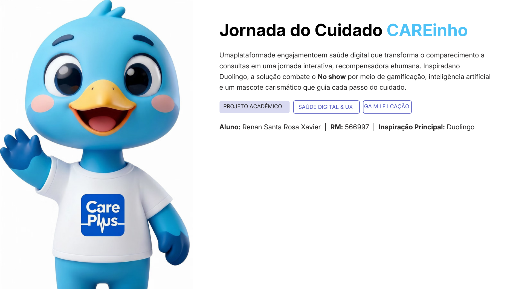
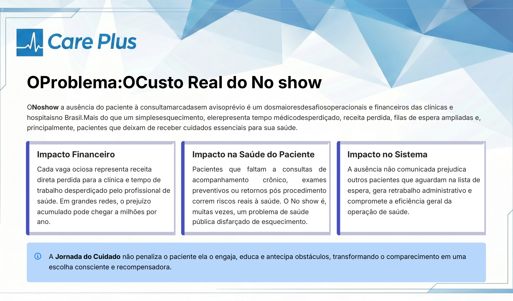
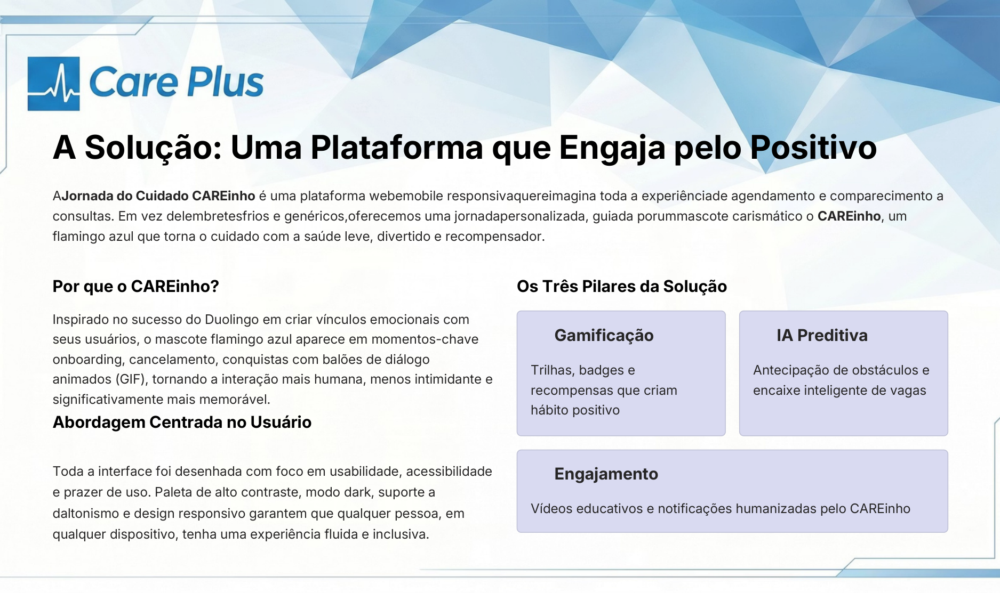
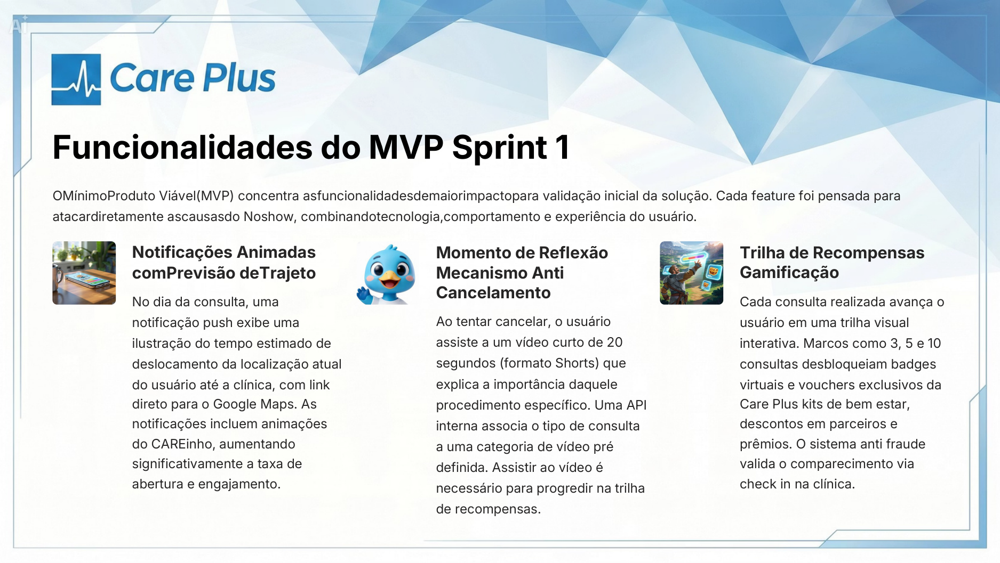
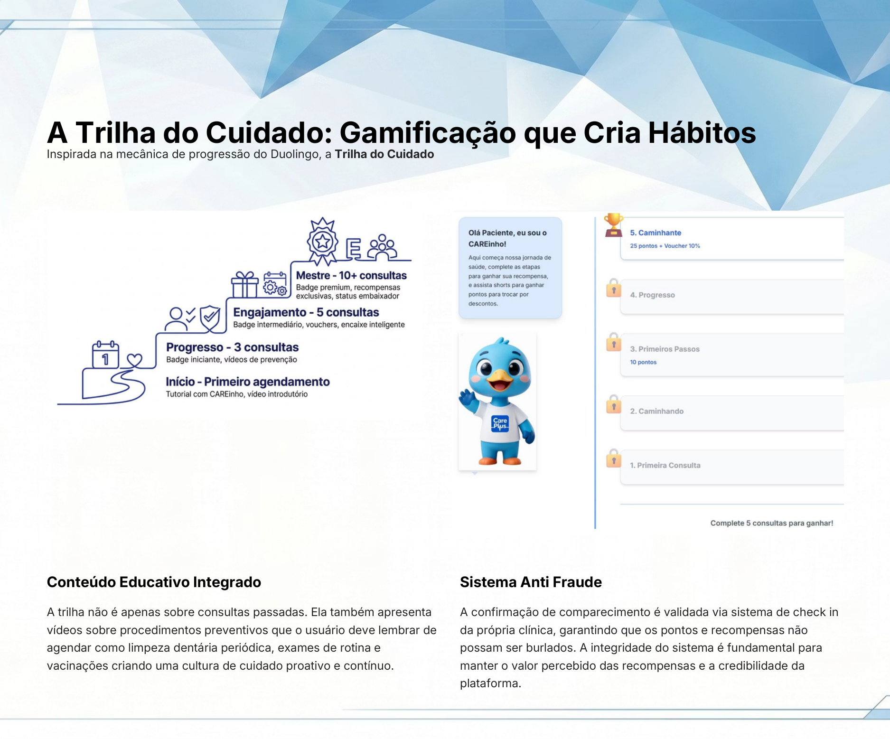
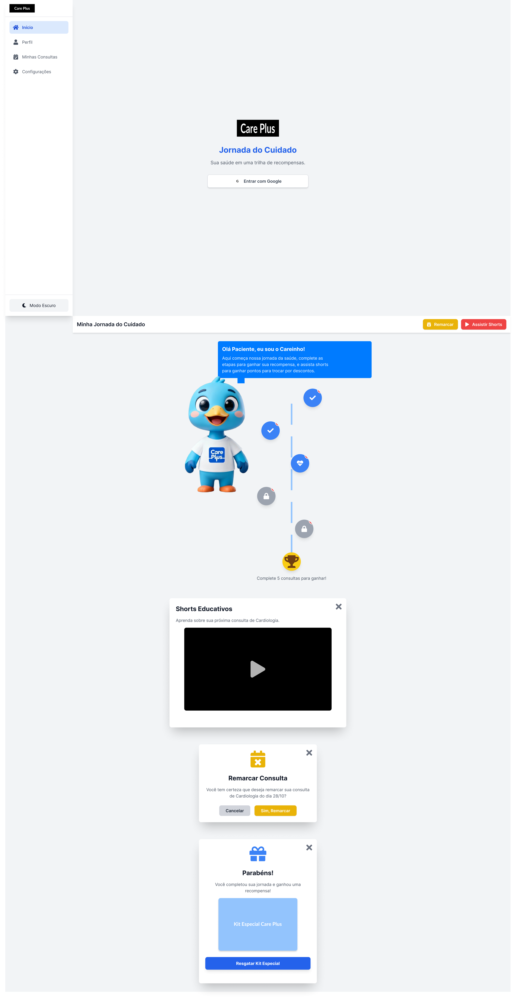
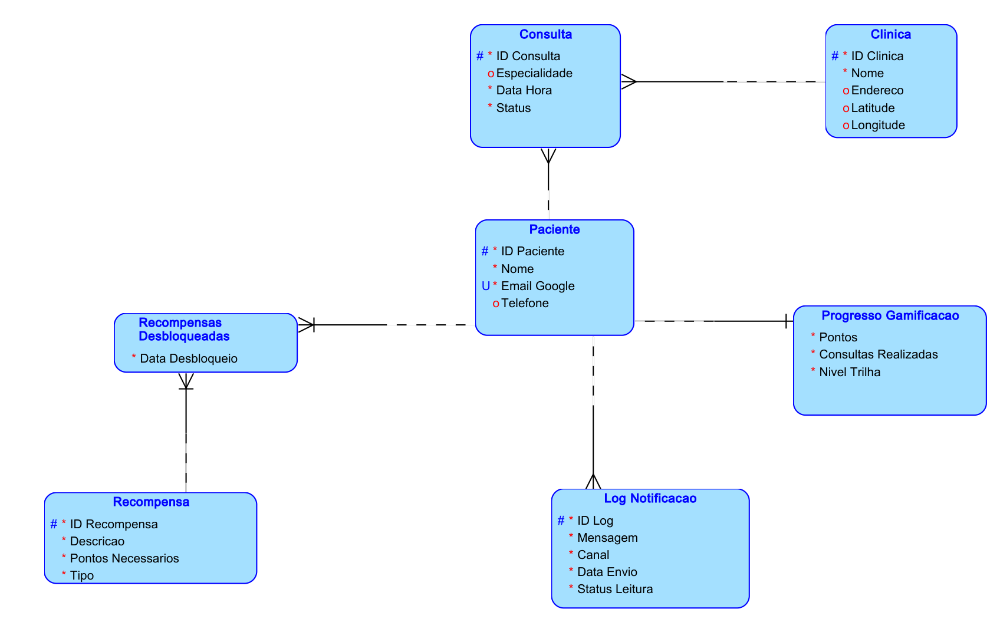

# Jornada do Cuidado (CAREinho) — Projeto Challenge FIAP


**Autor:** Renan Santa Rosa Xavier — RM566997

---

## Sobre o Projeto

O **CAREinho (Jornada do Cuidado)** é uma plataforma digital desenvolvida para o **Challenge FIAP** com foco na redução da taxa de **absenteísmo (*no-show*) em consultas e tratamentos médicos**. Em vez de apenas cobrar presença, a solução engaja pacientes e acompanhantes por meio de uma jornada gamificada, acolhedora e acessível.



---

## O Problema, a Solução e a Trilha Gamificada

| O Custo Real do No-Show | Engajamento pelo Positivo |
| :---: | :---: |
|  |  |

| Funcionalidades do MVP | A Trilha do Cuidado (Gamificação) |
| :---: | :---: |
|  |  |

---

## Protótipo de Interface e Modelagem de Banco de Dados

### Protótipo Navegável das Telas


### Modelo Lógico Relacional (MER)


---

## Estrutura do Repositório

- [`Challenge sprint 2/`](Challenge%20sprint%202): Aplicação Web Front-End construída com **React 18**, **Vite**, **Tailwind CSS** e integração com **Google OAuth (`@react-oauth/google`)**.
- [`MER challenge proj Jornada do cuidado/`](MER%20challenge%20proj%20Jornada%20do%20cuidado): Projeto completo de modelagem de dados no Oracle SQL Developer Data Modeler (`.dmd`).
- Documentações das etapas (`Etapa 1`, `Etapa 2 Modelo Lógico`, `Etapa 3 Protótipo` e `Apresentação CAREinho`).

---

## Como Executar a Aplicação React

```bash
cd "Challenge sprint 2"
npm install
npm run dev
```
A aplicação ficará disponível em `http://localhost:5173`.
